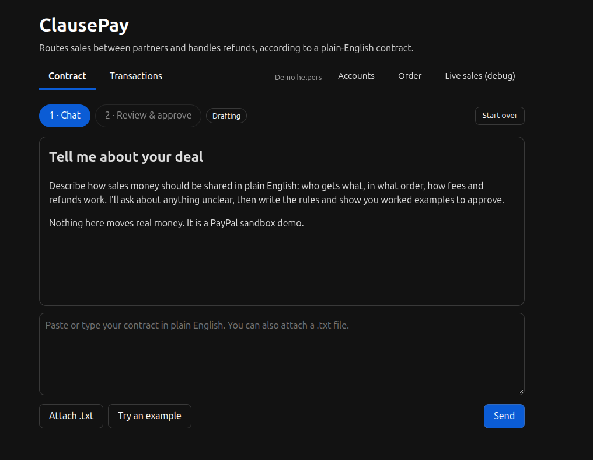
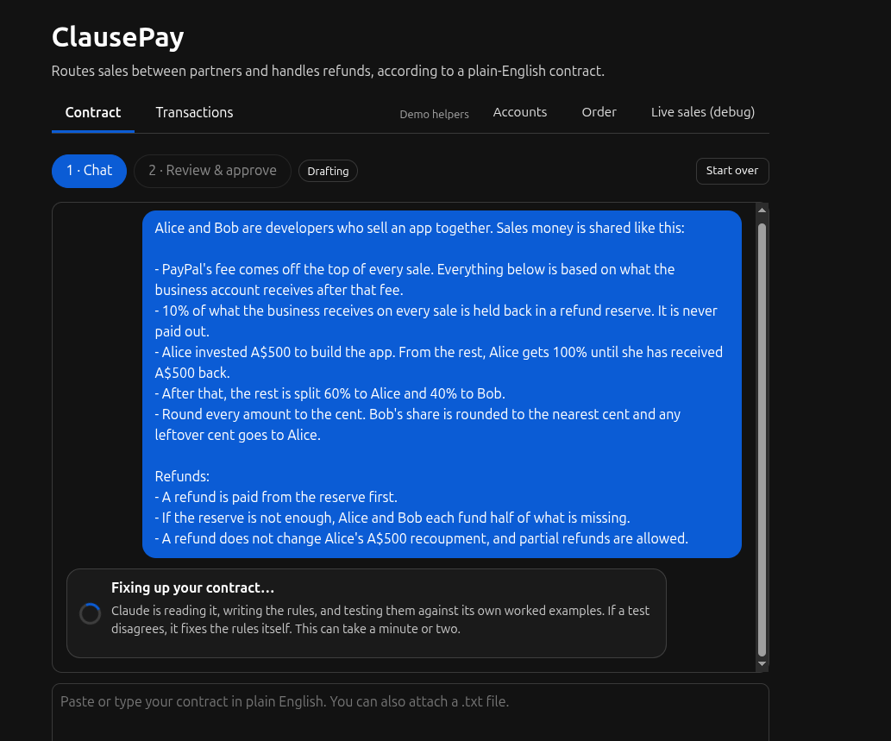
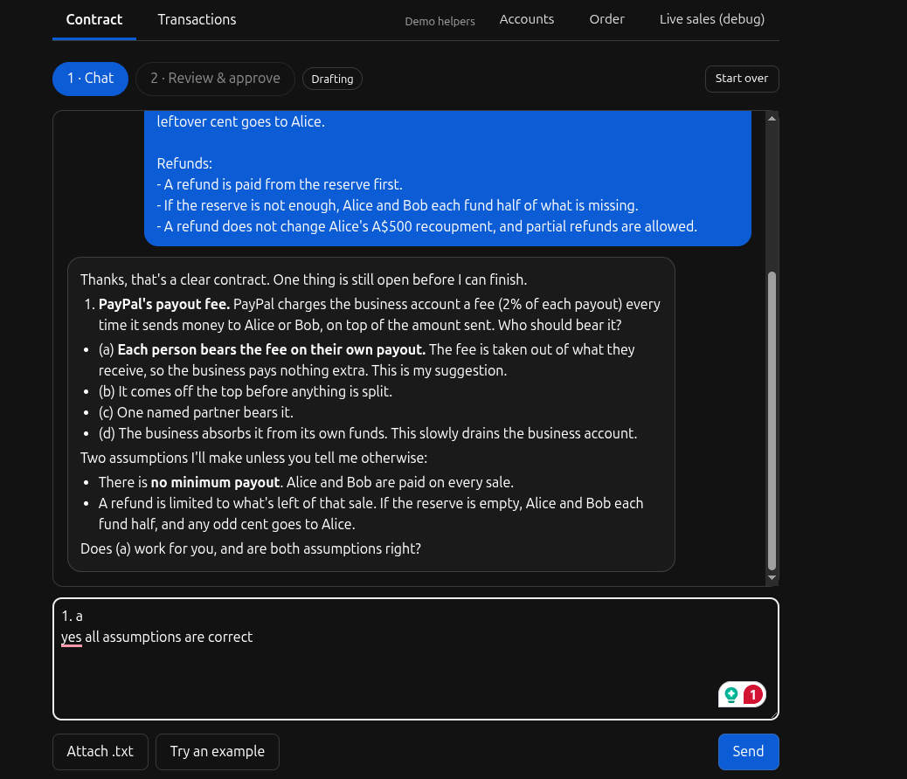
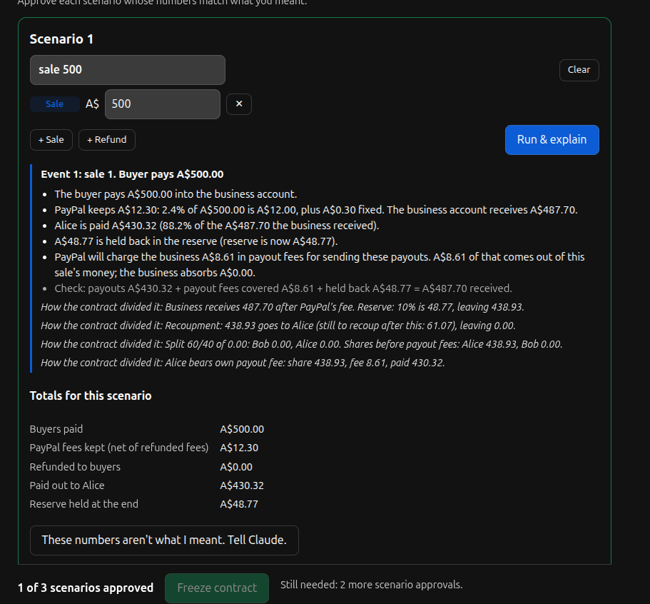
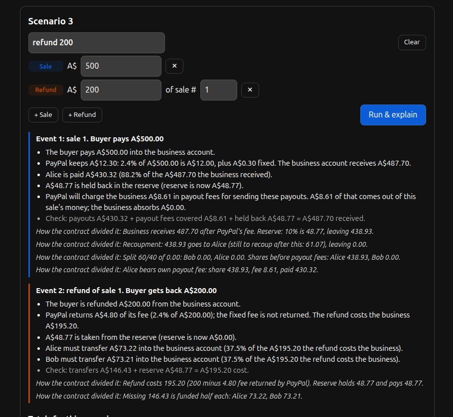

# ClausePay

ClausePay splits sales money between partners according to a contract written in plain English, and handles refunds the same way. You describe the deal in a chat, an AI turns it into code, you check that code against your own examples, and from then on every sale that comes in is divided and paid out automatically.  
**We have a hosted version for judges to try at** https://clausepay.onrender.com  
The hosted version includes claude api key which is set to expire on 23rd November with $5 AUD left. Please follow the readme to host the program with your own API key and sandbox credentials.

**This is a hackathon demo. It only talks to the PayPal sandbox, so no real money moves.**

## Tech Stack
- Python 3.15
- PapyPal API
- Anthropic Claude Sonnet 5.5
- Render Web Service

## How it works, in short

1. You write the contract as normal text ("Alice invested $500 and gets paid back first, then 60/40...").
2. Claude asks questions until nothing is ambiguous, then writes two small Python functions: one decides who gets what from a sale, the other decides who covers a refund.
3. ClausePay tests that code on its own, then you try it on three scenarios you write yourself and approve each one.
4. You freeze the contract. The code is locked and fingerprinted.
5. From then on, every sale PayPal reports runs through the frozen contract and the partners are paid. Each sale has a Refund button.

## Running it from scratch

### What you need

- Python 3.10 or newer (tested on 3.13 and 3.15)
- A free PayPal developer account, for the sandbox
- An Anthropic API key

### PayPal sandbox setup

1. On developer.paypal.com, go to **Testing tools > Sandbox accounts** and have these four: one **Business** account (it receives the sales) and three **Personal** accounts (two partners and one buyer).
2. Under **Apps & Credentials**, switch to Sandbox, create an app, and copy its client ID and secret. In the app's features, tick **Save payment methods**. ClausePay needs it to charge partners' wallets for refund shares.

### Settings

Create a file called `.env` in the project root:

```
client_id = <sandbox app client id>
client_secret = <sandbox app secret>
claude_key = <Anthropic API key>

business_email = <the business account's email>
u_1_email = <first partner's sandbox email>
u_2_email = <second partner's sandbox email>
buyer_email = <the buyer's sandbox email>

# optional
paypal_webhook_id =      # see "Webhooks" below
payout_fee_rate = 0.02   # PayPal's payout fee (the sandbox charges 2%)
payout_fee_cap =         # per-payout cap, empty means none
data_dir = data          # where the JSON files below are written
```

The app never needs any account passwords, only emails and the two API credentials. `.env` is git-ignored.

### Install and start

```
python -m venv .venv
source .venv/bin/activate          # Windows: .venv\Scripts\activate
pip install -r requirements.txt
python main.py
```

Open http://127.0.0.1:8000. If you use conda, create an environment, activate it and run the same `pip install` and `python main.py`. To use another port, set `PORT=8001`.

To run the tests (no keys or network needed):

```
pytest
```

### A first run

1. In the **Contract** tab, click *Try an example* or paste your own contract. Claude will ask a few questions. "Go with your suggestions" is a fine answer.
2. When it says the contract is ready, open **Review & approve**. Type a PayPal email for each partner (*Use the demo seller accounts* fills them in), write three scenarios of sales and refunds, run them, and approve each.
3. Freeze the contract. The app now opens on **Transactions** by default.
4. Open **Live sales (debug)**, start a test sale, and pay as the buyer in the PayPal window. Watch the contract run and the payouts go out.
5. On the Transactions tab, click **Authorize** for each partner once (they log in on PayPal and approve). After that, **Refund** collects each partner's share from their wallet automatically and refunds the buyer.

PayPal's sandbox login sometimes ends on a "Page unavailable" screen. Your login worked; just reopen the checkout link from the same window.

A sample contract to paste:

```
Alice and Bob are developers who sell an app together. PayPal's fee comes off the top of every sale, and everything
below is based on what the business account receives after that. 10% of every sale is held back in a refund reserve
and never paid out. Alice invested A$500, so from the rest she gets 100% until she has received A$500 back. After
that the rest is split 60% Alice, 40% Bob. Round to the cent and give any leftover cent to Alice. Refunds are paid
from the reserve first; if it isn't enough, Alice and Bob each cover half of what's missing. A refund does not change
Alice's recoupment, and partial refunds are allowed.
```

### Deploying on Render (Recommended and tested)

Create a Web Service from the repo. Build command `pip install -r requirements.txt`, start command:

```
gunicorn --workers 1 --threads 4 --timeout 180 "clausepay.webapp:create_app()"
```

Use one worker on purpose: a background thread, in-memory state and file locks all live inside the process. The long timeout is for Claude, which can take a minute when it writes code. In the service's **Environment** settings, add the same variables as in `.env` (except any passwords). The health check path is `/health`.

**Webhooks.** For ClausePay to see sales that PayPal reports, register `https://clausepay.onrender.com/webhooks/paypal` in your sandbox app for the `PAYMENT.CAPTURE.COMPLETED` event, then put the Webhook ID it shows into `paypal_webhook_id`. Without it, sales started from the Live sales page still work, because they run when the buyer returns from PayPal. A paid sale arrives twice (return and webhook) and is only ever processed once.

On Render's free plan the disk is wiped on every redeploy and when the service sleeps, so freeze a contract on the Render copy itself and expect to redo it after a redeploy.

## What's going on inside

### Refining the contract

Claude (`claude-sonnet-5-5`) answers every turn with JSON that follows a fixed schema: either a question for you or, once it is satisfied, the finished contract. Its instructions list what has to be pinned down: who gets what, in which order, who bears PayPal's fee and the payout fee, how money is rounded, whether payouts wait for a minimum balance, and exactly how refunds are funded. Emails never go through Claude. You type them into a form, so a model can't mistype or invent an address.

The contract becomes two pure functions with strict signatures:

```python
calculate_payout(sale_id, sale_amount, paypal_fee, state)
calculate_refund(sale_id, refund_amount, fee_returned, state)
```

They return amounts per party name, how much to hold back, a `state` dict, and plain-English notes. The rules are checked exactly, to the cent. For a sale, payouts + payout fees covered + held back must equal what the business received after PayPal's fee.

### Checking the code before you see it

Claude also writes three test cases with the results it expects, worked out from the contract text. ClausePay runs the generated code on them, plus a built-in set of awkward amounts, and compares exactly. If anything disagrees, the difference goes back to Claude to fix (up to three rounds). Only then does the Review tab appear. Your own three scenarios come after that, and if the numbers look wrong each one has a button that sends it back to Claude with the results.

### Freezing

Freezing needs three approved scenarios and an email for every partner. The code is written to a read-only file and its SHA-256 hash is stored next to it.

### Memory

The functions remember nothing. Everything a contract needs to remember, such as how much of an investment is still unpaid, lives in the `state` dict that goes in and comes back out. ClausePay keeps that dict in a per-contract **journal** file:

- every sale or refund is one entry, with its inputs, the contract's decision, the state before and after, and a status
- an entry starts as `pending` and only becomes `committed`, moving the memory forward, once PayPal confirms the payout. If the payout is denied it becomes `failed` and the memory stays put
- only one entry can be pending at a time, so later sales wait their turn
- sale and refund ids are unique, so a repeated notification from PayPal can't be counted twice
- amounts are stored as exact decimals (`{"__decimal__": "102.70"}`), never floats

### Real sales and refunds

When a sale arrives, ClausePay re-reads the payment from PayPal rather than trusting the notification, runs the contract, and pays the partners through PayPal Payouts. A background thread settles the payouts, starts any queued sales and writes the reports, so nobody needs a page open.

A refund first asks the contract what it would do, without recording anything. Partners with a saved wallet are charged their share automatically (they pay PayPal's fee on that charge, so the business receives exactly their share), then PayPal refunds the buyer, then the contract records it. A refund can only take from what is left of its sale, and every step carries a request id, so a double click or retry never charges anyone twice. If a charge fails half-way, the page offers a retry that picks up where it stopped.

### Reports

After each payout or refund a report is written for all the partners. ClausePay builds every figure and a list of what changed in the contract's memory. Claude only writes the explanation, and it is never shown a number: it uses placeholders that ClausePay fills in, and any text containing a number of its own is rejected. If Claude keeps failing, fixed wording is used. Sending the email is simulated; the report is shown in the Live sales tab marked as sent.

### The pages

| Tab | What it is |
|---|---|
| Contract | the chat, then Review & approve |
| Transactions | every sale, partner wallets, Refund buttons |
| Accounts, Order | demo helpers: the sandbox accounts, and a plain buy-and-see-the-funds page |
| Live sales (debug) | everything happening behind the scenes: PayPal notifications, activity log, the journal, payout-fee checks, reports, and a test-sale form |

### Where things are saved

Everything is plain JSON or Python under `data/` (git-ignored). Writes go to a temporary file first and are then swapped in, so a crash can't leave a half-written file.

| File | Contents |
|---|---|
| `contract.json` | the chat, the draft contract, your scenarios and approvals |
| `frozen/<id>-v1.py` | the frozen code, read-only |
| `frozen/<id>-v1.json` | its hash, the parties, their emails and the plain-English summary |
| `frozen/<id>-v1.journal.json` | the contract's memory (the journal described above) |
| `live.json` | live sales, refunds, reports and the activity log |
| `wallets.json` | partners' saved PayPal wallet tokens (readable by the owner only) |

### Security and safety checks

- **Generated code never runs unchecked.** It is parsed first and rejected if it imports anything, uses floats, loops without a bound, reaches into private attributes or calls anything outside a short allow-list. It then runs in a separate Python process with a restricted set of built-ins, a 5 second limit and CPU and memory limits. That is layered protection suited to a demo, not a perfect jail.
- **The maths is checked by ClausePay, not trusted.** The conservation rule, rounding to cents and the reserve are enforced in ordinary code on every sale and refund.
- **The code can't change after freezing.** Before every run its hash is recomputed and compared with the one recorded at freeze time and with the one in the journal. A mismatch stops that contract and nothing is paid. A damaged journal also stops everything instead of silently resetting.
- **PayPal's notifications are verified** with PayPal's signature check before anything happens. The sale itself is re-read from PayPal, and the fees PayPal reports must match what was expected, or the transaction pauses.
- **Money is handled as exact decimals,** and amounts have to be positive whole cents.
- **Wallet safety.** A wallet is only saved if the PayPal account that approved it has the partner's own email. Charges are tagged so they are never mistaken for sales.
- **Secrets** come only from environment variables. Passwords aren't used at all, and the wallet file is created with owner-only permissions.

### Known limits for MVP

- Sandbox only. The sandbox fees (2.4% + A$0.30 per sale, 2% per payout) differ from PayPal's published rates, so treat them as settings.
- One contract and one user at a time.
- Wallet tokens are stored in a plain file, which is fine for a demo and not for production.
- Not handled: disputes and chargebacks, and refunds made outside ClausePay (they are only logged).

### Project layout

```
main.py                 starts the web server
clausepay/
  webapp.py             routes and pages
  contract_chat.py      the conversation with Claude and its instructions
  contract_sim.py       dry runs, the exact checks, scenarios
  contract_sandbox.py   safe checking and running of the generated code
  contract_store.py     the draft, approvals and freezing
  contract_runner.py    the journal, the memory and the hash check
  live.py               real sales, refunds, payouts, background worker
  wallets.py            partner wallets and charges
  reports.py            the partner reports
  fees.py               fee arithmetic
  paypal_client.py      thin wrapper around PayPal's REST API
  orders.py, accounts.py  the demo helper pages
  contract_payments.py  an early sketch that the runner replaced; not used by the app
tests/                  pytest suite
```

## Screenshots
Contract home:\


Reading contract:\


Refine:\


Review and approve:\


Scenario 1 (Sale):\


Scenario 3 (Refund):\

